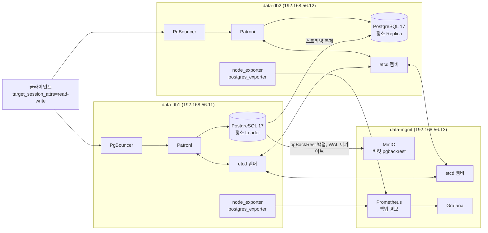

> 구축 코드와 검증 결과. 수동 실습 기록은 진행 중

# postgresql-patroni-ha

VM 3대에 PostgreSQL 17 스트리밍 복제를 만들고, 그 위에 Patroni, etcd, PgBouncer, pgBackRest, MinIO, Prometheus, Grafana를 올려 고가용성 구성을 코드로 재현한 실습이다.

## 구성도



etcd 세 번째 멤버를 관리 서버에 두어 DB 서버 한 대가 멈춰도 정족수가 유지되게 했다.

## 한 일

- Vagrantfile 하나로 VM 3대, 데이터 디스크, 단계별 provision을 정의했다. provision은 자동으로 돌지 않고 순서대로 하나씩 실행한다.
- 먼저 수동 스트리밍 복제(복제 사용자, `pg_basebackup`, 복제 슬롯)로 Primary와 Standby를 만들고, Standby가 읽기 전용인지 확인했다.
- 그 위에 Patroni와 etcd 3대를 올려 자동 전환 구성으로 넘겼다. softdog watchdog을 `mode=required` 로 켰다.
- PgBouncer로 접속 경로를 만들고, pgBackRest로 MinIO(S3 호환)에 백업과 WAL 아카이브를 보냈다.
- 백업 시각을 지표로 만들어 Prometheus 경보(`PgBackRestBackupTooOld`)를 걸고 Grafana 대시보드를 붙였다.
- 비밀번호는 코드에 넣지 않았다. 호스트의 비밀값 폴더를 VM의 root 전용 폴더로 옮기고 원본은 지우며, 스크립트는 파일에서 읽기만 하고 화면에 출력하지 않는다.
- 실습을 스크립트로 만들었다. 쿼리 튜닝, 백업과 복구, 수동 페일오버(`pg_promote`, `pg_rewind`), Patroni switchover, 잠금과 VACUUM, 장애 훈련(Primary 강제 종료, 망 분리, etcd 정족수, 백업 실패와 경보, PITR)을 스냅샷 복원부터 정리까지 한 번에 돌린다 (`run_all_labs.ps1`).

## 결과 숫자

이력서에 올린 숫자는 아직 없다. 지금까지 확인한 결과는 아래와 같고, 원문 로그는 `results/` 에 있다.

| 항목 | 상태 | 근거 |
|---|---|---|
| 구축 (복제, Patroni, etcd, PgBouncer, pgBackRest, 모니터링) | 통과 | `docs/setup-guide.md` 최종 확인 체크리스트 |
| 구축 중 switchover 왕복 | 통과 | 구축 기록 |
| 실습 1 쿼리 튜닝 (Leader, Replica) | 코드 실행 통과, 튜닝 전후 결과 같음 확인 | `results/lab1_tuning_*.log`, `docs/lab1-query-tuning.md` |
| 실습 2 백업과 복구 | 코드 실행 통과 | `results/labs/lab02_backup_restore.log`, `docs/lab2-backup-restore.md` |
| 실습 3 수동 페일오버 | 코드 실행 통과 | `results/labs/lab03_manual_failover.log` |
| 실습 4부터 10까지 | 미완. full 스냅샷 복원 뒤 Replica가 streaming 상태로 돌아오지 않아 자동 실행이 멈췄다 | `results/labs/runner_20261105_235957.log` |
| 같은 실습을 손으로 다시 하기 | 진행 중 | |

## 겪은 문제와 해결

### 1. Vagrant가 box를 찾지 못했다
- 원인: 설치된 Vagrant가 32비트 루비로 돌아 호스트를 i386으로 인식했고, amd64 box를 찾지 못했다.
- 해결: Vagrantfile에 `config.vm.box_architecture = "amd64"` 를 넣었다.
- 이유: 호스트를 다시 설치하지 않고 설정 한 줄로 해결할 수 있었다.

### 2. Patroni 설치가 watchdog 확인에서 멈췄다
- 원인: VirtualBox ICH9 칩셋이 iTCO를 흉내 내서 `iTCO_wdt` 가 `/dev/watchdog` 를 먼저 차지했다.
- 해결: `iTCO_wdt` 와 `iTCO_vendor_support` 를 내리고 blacklist에 넣은 뒤 softdog를 올리고 initramfs를 다시 만들었다.
- 이유: `mode=required` 에서는 Patroni가 watchdog을 잡지 못하면 승격하지 않는다. 엉뚱한 드라이버가 장치를 잡으면 자동 전환이 막힌다.

### 3. Prometheus가 포트를 잡지 못했다
- 원인: Rocky Linux 기본 `cockpit.socket` 이 같은 포트를 쓰고 있었다.
- 해결: 관리 서버에서 `cockpit.socket` 을 껐다.
- 이유: 관리 서버에서는 cockpit을 쓰지 않고, 모니터링 포트를 바꾸면 다른 설정도 함께 바꿔야 했다.

### 4. Grafana admin 비밀번호가 적용되지 않았다
- 원인: 비밀번호 파일을 읽었다는 로그는 있었지만 적용되지 않았다. 근본 원인은 확정하지 못했다.
- 해결: `grafana cli admin reset-admin-password --password-from-stdin` 으로 파일에서 읽어 다시 정했다. CLI가 기본 데이터 경로를 열어 실패해서 `--configOverrides` 로 경로를 지정했다.
- 이유: 비밀번호를 명령 줄이나 화면에 남기지 않으려면 표준 입력으로 넘겨야 했다.

### 5. 스냅샷을 되돌리면 etcd와 PostgreSQL 상태가 어긋났다
- 원인: 한 대씩 켜진 채 되돌리면 살아 있는 etcd의 새 기록이 되돌린 VM으로 다시 들어온다. 실행 중에 찍은 스냅샷이라 시계도 스냅샷 시각에 머문다.
- 해결: 세 VM을 모두 끈 뒤 되돌리고, 되돌린 뒤 호스트 시각으로 시계를 맞추고, Patroni `resume` 뒤 Leader와 Replica 상태를 확인하게 스크립트(`lab_ctl.sh`)를 만들었다.
- 이유: 실습마다 같은 출발점에서 시작해야 결과를 비교할 수 있다.

### 6. 첫 부팅에서 커널이 멈췄다
- 원인: 콘솔에 hung task 기록이 남았지만 근본 원인은 확정하지 못했다.
- 해결: 강제 종료 뒤 다시 켜고 `boot_timeout` 을 늘렸다. 이후 같은 증상은 다시 나오지 않았다.
- 이유: 다시 나오면 데이터 디스크 컨트롤러를 바꾸는 안을 검토하려고 기록만 남겼다.

### 7. 남은 문제
- full 스냅샷 복원 뒤 Replica가 streaming 상태로 돌아오지 않아 실습 4부터 자동 실행이 멈춘다. 원인을 아직 찾는 중이다.

## 따라 하는 법

PowerShell 창을 열 때마다

```powershell
$env:VAGRANT_HOME = "<이 저장소 폴더>\.vagrant_home"
```

비밀값 파일은 저장소에 없다. 저장소 폴더 아래 `.secrets` 폴더를 만들고 `repl_pw`, `postgres_pw`, `lab_app_pw`, `minio_access_key`, `minio_secret_key`, `grafana_admin_pw` 파일에 직접 정한 값을 넣는다.

VM 올리기

```powershell
vagrant up
```

기본 설정과 PostgreSQL 설치 (`00_copy`, `01_base` 는 세 VM, `02_pg17` 은 data-db1, data-db2에 실행)

```powershell
vagrant provision data-db1 --provision-with 00_copy
```
```powershell
vagrant provision data-db1 --provision-with 01_base
```
```powershell
vagrant provision data-db1 --provision-with 02_pg17
```

복제는 VM 안에서 `scripts/03_replication.sh` 를 실행한다. 확장 구성(`00_secrets`, `05_secrets` 부터 `12_monitoring` 까지)의 순서와 VM별 대상은 `docs/setup-guide.md` 에 있다.

상태 확인 (VM 안)

```bash
sudo patronictl -c /etc/patroni/patroni.yml list
```
```bash
sudo -u postgres pgbackrest --stanza=lab info
```

실습 자동 실행

```powershell
powershell -ExecutionPolicy Bypass -File run_all_labs.ps1
```

## 폴더

| 위치 | 내용 |
|---|---|
| `Vagrantfile` | VM 3대, 데이터 디스크, provision 정의 |
| `scripts/01_base.sh` 부터 `12_monitoring.sh` 까지 | 구축 단계별 스크립트 |
| `scripts/13_tuning.sh` 부터 `22_drill_pitr.sh` 까지 | 실습과 장애 훈련 스크립트 |
| `scripts/lab_lib.sh`, `scripts/lab_ctl.sh` | 실습 공통 함수, 스냅샷 복원 뒤 준비 |
| `run_13_tuning.ps1`, `run_all_labs.ps1` | 호스트에서 실습을 한 번에 돌리는 스크립트 |
| `docs/setup-guide.md` | 단계별 구축 안내 |
| `docs/lab1-query-tuning.md`, `docs/lab2-backup-restore.md` | 실습 1, 2 결과 정리 |
| `results/` | 실습 실행 로그 |
